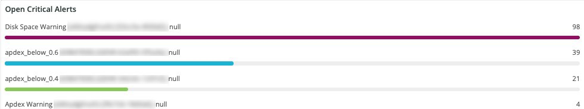

# [!UICONTROL Alerts]索引標籤

[!UICONTROL Alerts]索引標籤提供一系列警示，包括開啟和關閉嚴重警示。

## [!UICONTROL Open Alert Details]

**[!UICONTROL Open Alert Details]**&#x200B;時間範圍顯示所選時間範圍內未解決的嚴重性警報的計數。 警報將包含Adobe建立的警報，以及任何由合作夥伴或商家建立的警報。

## [!UICONTROL Closed Critical Alerts]

**[!UICONTROL Closed Critical Alerts]**&#x200B;時間範圍顯示所選時間範圍內已關閉嚴重性警示的計數。 警報將包含Adobe建立的警報，以及任何由合作夥伴或商家建立的警報。

## [!UICONTROL Critical Alert Details]

**[!UICONTROL Critical Alert Details]**&#x200B;時間範圍顯示所選時間範圍內嚴重警示詳細資料的計數，包括時間戳記、條件名稱，以及警示事件是開啟還是關閉。

## [!UICONTROL Infrastructure Alert Details]

**[!UICONTROL Infrastructure Alert Details]**&#x200B;框架會顯示所選時間範圍內的應用程式、主機和其他基礎結構事件。
