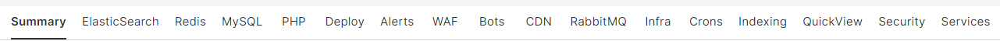

# 選擇[!UICONTROL focus]標籤

[!DNL Observation for Adobe Commerce]的強大功能來自於在相同時間線上對齊大量不同的資料檢視。 [!DNL Observation for Adobe Commerce]可以呈現[!DNL New Relic]個代理程式，其中包含收集的資料範例以及系統和應用程式記錄檔的視覺化檢視。 如果您考慮疑難排解複雜問題，永遠都會將資料分割一半。 檢視時間表上的問題時，第一個問題是「這是何時發生的？」 立即需要關注的是那一刻之前發生的一切。 如果您知道問題在時間表上發生的確切時間，您可以選取緊接問題之前的時間表。 您可能不知道問題的詳細資訊，除了您的網站停止運作或速度緩慢以外。 使用Adobe Commerce時，可能的疑犯包括元件服務、資源層級，以及執行的程式數量。

**[!UICONTROL focus]**&#x200B;標籤顯示的資訊可協助您專注在導致或造成問題的區域。 您也可以持續新增資料訊號至[!DNL Observation for Adobe Commerce]。 資料訊號可以是[!DNL New Relic]個收集的資料或關鍵階段的計數，或是記錄檔中的錯誤訊息。 由於錯誤訊息被識別為與網站問題相關，因此可將其新增到[!DNL Observation for Adobe Commerce]查詢以幫助改善關鍵資訊的顯示。

