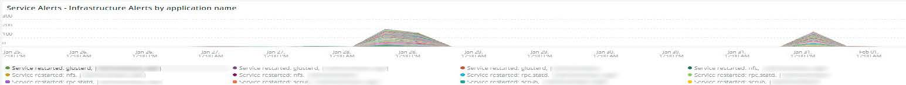
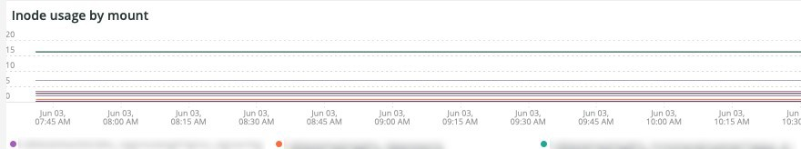
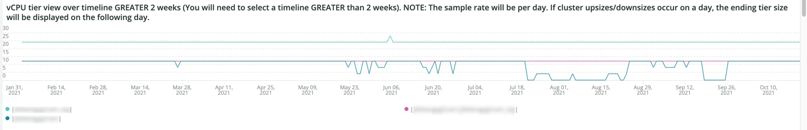
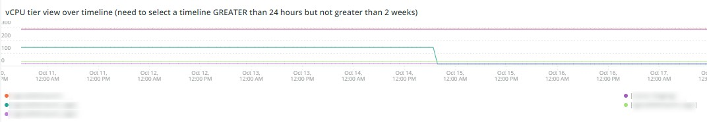
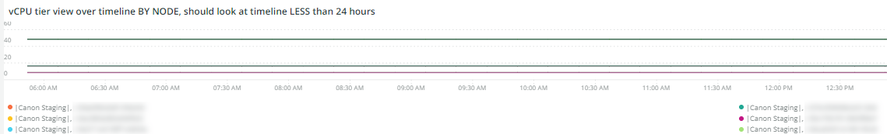
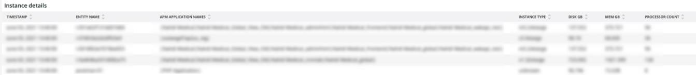
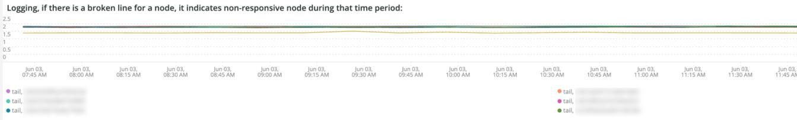

# [!DNL Infra]索引標籤

**[!DNL Infra]**&#x200B;索引標籤可隔離基礎架構問題的問題和原因。 進一步說明您可以在標籤上看到的框架。

## [!UICONTROL Service Alerts – Infrastructure Alerts by Application name]

**[!UICONTROL Service Alerts – Infrastructure Alerts by Application name]**&#x200B;圖表顯示[!DNL New Relic]基礎結構代理程式所收集的服務警示。 這會顯示服務重新啟動，其中許多與部署有關。

## [!UICONTROL Inode usage by mount]

**[!UICONTROL Inode usage by mount]**&#x200B;框架顯示所選時間範圍內掛載的[!DNL inode]使用量。 即使可能有足夠的可用儲存空間，如果節點用完[!DNL inodes]，會顯示缺少可用的儲存空間。 移除檔案（尤其是小型檔案）將釋放兩個空間，並使[!DNL inodes]可用。

## [!UICONTROL vCPU tier view over timeline GREATER 2 weeks]

**[!UICONTROL vCPU tier view over timeline GREATER 2 weeks]**&#x200B;框架會在超過兩週的選定時間範圍內顯示vCPU層檢視。 此框架會檢視指派給所顯示[!DNL New Relic]應用程式名稱的vCPU數量。

## [!UICONTROL vCPU tier view over timeline]

**[!UICONTROL vCPU tier view over timeline]**&#x200B;框架會在超過24小時的所選時間範圍內顯示vCPU層檢視。 此框架會檢視指派給所顯示[!DNL New Relic]應用程式名稱的vCPU數量。 它會顯示叢集向上和向下移動。

## [!UICONTROL vCPU tier view over timeline BY NODE]

依節點在時間線上檢視vCPU層

**[!UICONTROL vCPU tier view over timeline BY NODE]**&#x200B;框架會依節點顯示所選時間範圍內的vCPU層檢視。 此框架有助於偵測節點遺失，或節點已放大或縮小時。 依節點依時間表的vCPU層檢視，應檢視少於24小時的時間表。

## [!UICONTROL Instance details]

**[!UICONTROL Instance details]**&#x200B;表格顯示每個[!DNL New Relic]應用程式的執行個體詳細資料。

## [!UICONTROL Logging, if there is a broken line for a node, it indicates non-responsive node during that time period]

**[!UICONTROL Logging, if there is a broken line for a node, it indicates non-responsive node during that time period]**&#x200B;框架顯示一段時間內無回應的節點。
