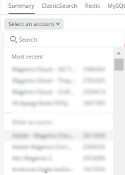

# 選取帳戶和時間範圍：

當您按一下[!UICONTROL Observation for Adobe Commerce]圖示時，[!DNL Observation for Adobe Commerce] Nerdlet將會開啟。

1. 按一下&#x200B;**選取帳戶**&#x200B;下拉式清單。 如果您沒有看到&#x200B;**選取帳戶**&#x200B;下拉式清單，則可能沒有存取權。 按一下[這裡](https://adobe.sharepoint.com/sites/MG/it/IT%20Services%20Wiki/Requesting%20access%20to%20Magento%20Commerce%20New%20Relic.aspx)以要求存取權。

   

1. 您可以貼上project_id、輸入[!DNL New Relic]帳號或帳戶名稱，或瀏覽帳戶清單。

   

1. 按一下帶有時鐘圖示的&#x200B;**淺藍色** （朝向Nerdlet視窗右上方）下拉式功能表。

   

1. 您應該設定票證日期時間之前的時間，以檢視是否有任何先前的事件/資料。 您可以使用左側的預設時間範圍，或選取「**設定自訂**」以設定自訂時間範圍。
