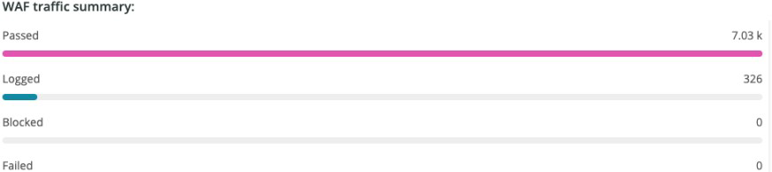
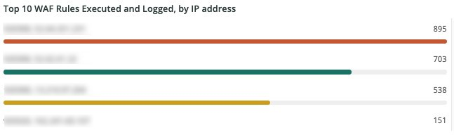
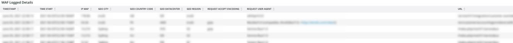

# [!DNL WAF]索引標籤

**[!DNL WAF]**&#x200B;索引標籤顯示[!DNL firewall]已傳遞及封鎖的流量。

## [!DNL WAF traffic summary]

**[!DNL WAF traffic summary]**&#x200B;框架顯示[!DNL firewall]已通過、已記錄、已封鎖及失敗的流量計數。

## [!DNL WAF Top 10 blocked IP Addresses]

**[!DNL WAF Top 10 blocked IP Addresses]**&#x200B;框架顯示[!DNL firewall]封鎖的前10個最常使用的IP位址。

## [!DNL WAF Top 10 countries for blocked requests]

**[!DNL WAF Top 10 countries for blocked requests]**&#x200B;框架顯示[!DNL firewall]針對封鎖的請求前10名國家/地區的封鎖請求計數。

## [!DNL WAF Top 10 logged IP Addresses]

**[!DNL WAF Top 10 logged IP Addresses]**&#x200B;框架顯示[!DNL firewall]所記錄的前10個IP位址中的IP位址。

## [!DNL Top 10 WAF Rules Executed and Logged by IP address]

**[!DNL Top 10 WAF Rules Executed and Logged by IP address]**&#x200B;框架顯示前10個最符合[!DNL firewall]個規則的IP位址。

## [!DNL WAF Logged Details]

**[!DNL WAF Logged Details]**&#x200B;框架會顯示[!DNL firewall]所記錄的請求，包括時間戳記、城市、地區和資料中心等詳細資訊。

## [!DNL WAF Blocked Details]

**[!DNL WAF Blocked Details]**&#x200B;框架顯示被[!DNL firewall]封鎖的請求，包括時間戳記、城市、地區和資料中心等詳細資訊。
